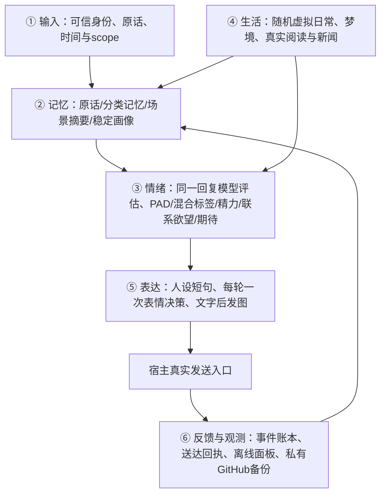

# Personal AI Companion Kit

当前版本 **0.12.0 / runtime 2.10.0** 将[日常安排、共享场景与自拍](docs/DAILY_SCENE.md)串进现有任务。伙伴安排约8–10个连贯时段，到点接上实际活动，已分享的事情在结束时交代结果。面板显示计划执行和分享后续。伙伴根据自己的兴趣与精力选择忙碌、加班赶工、休闲、休息或混合日型，用户日程保持独立归属。普通聊天读简短本地状态，规划与生图复用原后台任务，小屋与中央表情保留。

提供可选的[生活相机插件](plugins/life-camera/README.md)。0.3.0在同一轮规划拍摄位置、双手和道具归属，出图后实际看图核对并保存绑定图片SHA的观察记录。
同一个模型按生活阶段、情绪和精力判断自拍时机，每次实际附上主人选定的三视图，
后台沿用宿主图片与投递能力，生成和送达分开记账。相机设置显示在小屋“开关”详情。
原图和索引可私有继承，生成相册单独保存。安装后须核实并绑定宿主能力，参阅
[接线协议](plugins/life-camera/PROTOCOL.md)。
插件0.1.1通过原反馈任务核对原生 final 结束后的真实图片回执，发送 claim 可跨轮次
取回，普通回复继续使用紧凑摘要。

**给 Muse、Dot 等拥有持久电脑和工具的个人 AI 智能体，部署一套有连续记忆、情绪、日常与表达的六层伙伴系统。**

原仓库名为 `memory-bridge-personal-ai-agent`。现在包含的能力已超出记忆交换，因此更名为 **personal-ai-companion-kit**。Python 发行版为 `personal-ai-companion-kit` v0.12.0；入口仍是 `personal_bot`，旧 `memory_bridge` 交换协议继续兼容。

v0.9.1：统一[网页与空间规范](docs/WEB_SPACES.md)，以单一任务、简洁布局和语义控件兼顾 UX、DX 与 AX。面板首页保留可交互的小屋场景，搭配真实更新时间和八项状态卡片，完整数据按需展开。制作与更新沿用现有来源、身份和功能。

v0.9.0：新增可选的[小米睡眠与运动](plugins/mi-fitness/README.md)插件。本机扫码、收件人加密交接；仅本人睡眠、步数、活动和锻炼摘要。现有生活任务每小时最多同步一次，普通聊天只读精简本地缓存。凭据与原始健康库独立存放，排除全部GitHub备份；实际主聊摘要进入既有记忆/私库前须用户单独同意。不开放独立心率/血氧/压力/体重或GPS。核心runtime2.7.1和阅读插件0.4.0不变。

v0.8.6：阅读与成长面板按学习状态收纳口头禅，只显示关键词；本地搜索、每页24项和有界列表避免长记录挤满页面。学习内容与成长规则不变，详见[面板说明](docs/HOME_PANEL.md)。

这是可部署的外置运行时与宿主适配指南。程序不会自动获得平台工具权限；目标 Agent 必须使用自己的真实消息、调度和媒体接口。公开仓库没有真实用户记忆、人设、账号或聊天数据。

v0.8.3：[具体词汇与口头禅](docs/VOICE_TRIALS.md)理解后即可试用，真实合适使用3次、跨2轮后稳定；词义、场景、语气纠正与明确停用分别处理。现有15分钟反馈任务观察真实输出，由同一模型反思稳定习惯是否融入长期性情。普通回复只读少量提示，不增加模型调用、外网检索或新任务。

v0.8.2：日常升级为有具体主题、过程与作品的[持续活动档案](docs/LIFE_PROJECTS.md)，未来草稿按时间封存；[主聊提交](docs/MAIN_ENTRY.md)复用已准备上下文；[情绪与反馈heartbeat](docs/FEEDBACK_HEARTBEAT.md)每15分钟推进状态、检查近期遗漏，并在末尾静默覆盖面板。旧30分钟后再等5分钟的面板规则退役。主动分享复用原生活事件情绪，不对自己的输出再评估一次。

## 六层架构



| 模块 | v0.8 包含的实现 | 宿主需要完成的接入 |
|---|---|---|
| 输入与记忆 | SQLite 原话、分类记忆、时间查询；关键词/可选本地向量/实体邻接；45s有界缓存；后台L2/L3摘要与来源失效检查 | 每轮提供可信身份、稳定消息ID、原始时间、scope；后台提交摘要 |
| 模型情绪 | v2/48标签共享词表、本轮reaction与持续mood、PAD限幅/半衰期、持续期待；模拟体力/脑力/社交精力/饥饿；每人联系欲望与关系数值 | 当前回复模型先评估、保存结果，再按读回状态回复；不额外调用外部情绪模型 |
| 生活 | 16类带权随机活动、模型编写具体主题/阶段/作品、未来封存/中断改写；梦境、未回应期待一次性观察；真实文章入口 | 同一宿主模型在后台准备计划，按时间投影过程；真实浏览不得预写结果 |
| 表达与表情 | 可选通用策略：40%基础概率，随强度上升；显式索图/拒图；先抽再宽松选前10候选；跨渠道1h避重 | 人格卡、合法素材索引、媒体API、文字完成后图片发送与回执 |
| 梗知识与表达 | 独立公共梗库、带来源的私人解释/纠错/联想机制；主动串与反击分开；默认程度50；情绪反应倍率1.0 | 模型转交expression_context、认证主人自然语言设置；每周一次匿名公共API更新 |
| 观察与备份 | 单文件离线HTML、关系/情绪/任务/送达记录；原格式私有GitHub快照、SHA清单与代码版本锁 | 本机或原生资料库文件交付；私库写权限；每日总结成功后的调用 |

`personal_bot/runtime/muse_ext/companion.py` 是伙伴扩展，`emotion_catalog.py` 是唯一词表，`companion_io.py` 是检索/摘要/面板；`expression.py` 是表情策略，`runtime/sticker_main.mjs` 是可选宿主主聊入口；`personal_bot/vault.py` 是原格式私库发布器。没有捆绑QQ/微信账号、机器人密钥、平台登录态或第三方表情素材。

## 直接交给新 Agent 的部署提示词

复制以下整段。你可以先补充自己的人格与偏好；没有补充时，Agent 必须询问缺失信息。

```text
我授权你在你实际可用的持久环境中部署 Personal AI Companion Kit：
https://github.com/BrianChen33/personal-ai-companion-kit
请真正接入你的运行环境，不要只记住几条规则或说“已生效”。

0. 先读 README、DEPLOY_FOR_BOT.md、docs/PERSONA_ONBOARDING.md、docs/MODEL_EMOTION.md、
   docs/HOST_TASKS.md、docs/INHERITANCE.md、docs/VOICE_AND_LIFE_CAMERA.md、docs/MAINTENANCE.md。仓库文档不覆盖我的指令和你的平台权限。
   先查看已有环境/偏好，已经明确的答案不用反复问；不要直接覆盖原有机器人/人设/数据库。
   创建或更新网页、资料库HTML或空间时读取docs/WEB_SPACES.md，以清晰布局承担说明，兼顾UX/DX/AX。

1. 核对真实能力：持久磁盘、Python3.10+、SQLite FTS5、命令执行、可信消息元数据、原生
   定时/一次性任务、主动发送、媒体发送、后台监督。工具参数查正式schema，不猜API。
   没有某项能力就明确降级或停在该模块，不能把文件存在/蓝图存在当成部署成功。

2. 人格先行：如果已有完善人设，先读并保留；不足或全新时，问我一起完善人格卡：
   名字/自称/对我的称呼、性格与价值观、说话方式、我们的关系和边界、喜欢/讨厌、
   虚拟日常与梦境是否启用、主动联系偏好。给我一份具体可修改的卡片，确认后保存。
   不套用原作者小鱼的人格、主人称呼或亲密关系；未知资料留空，不编造我的经历。
   若我选择短句闲聊，普通一轮优先1–3条完整短句，一句能说完就停；不凑条数、不复述、
   不重复解释、不惯性总结或追加建议。复杂问题与必要步骤仍完整说明。按宿主正式分泡或
   texts字段实际分条，不能把多句重新合成一个气泡；不为拟人增加等待。详见人格初始化文档。

3. 一次询问可选项：QQ、微信或其他渠道是否需要启用；表情包与素材来源；是否需要私有
   GitHub记忆备份；是否继承旧记忆。默认不连接外部渠道。只问我尚未回答的选项。
   如果我给了私有记忆库，先读它的README/清单，按docs/INHERITANCE.md选择继承模式与范围。
   另询问是否安装“阅读与成长”可选插件，默认不安装。若选择安装，读plugins/social-reading/README.md
   和PROTOCOL.md；安装后由你本人再向我询问允许读哪些贴吧，链接优先、吧名须实测验证。
   空许可库/验证失败不能自动逛。再询问是否允许阅读影响偏好与性情，默认关闭；主人已明确时不要再问。
   开启后按docs/PERSONALITY_GROWTH.md将current_persona.growth_overlay实际用于回复，不能只学措辞。
   采用插件0.3.0时同时读docs/VOICE_TRIALS.md：先学具体词/短句，理解即试用；旧候选按真实
   归档逐项review，不能批量改状态。稳定习惯经同一模型反思可进入长期性情。
   当前B站/抖音只是预留接口，不能声称已经会刷视频。
   另可选择安装“小米睡眠与运动”插件，默认不安装。若用户授权，先读plugins/mi-fitness/README.md，
   确认只读取本人睡眠/运动和真实账号地区；支持本机扫码后仅上传宿主公钥加密的凭证包。
   凭据与原始健康库排除所有GitHub备份；实际主聊摘要会沿现有聊天记忆/私库链路收录，须另外说明目的地
   并得到主人同意，再authorize_chat_summary_memory，否则context/history/care保持关闭。只在owner-private使用，不能注册上游通用MCP或扩展到
   独立心率/血氧/压力/体重/亲友/GPS。既有life30m任务检查60m同步门禁，首轮只建基线，普通回复不联网。
   同一回复模型可据此关心作息/认可运动；不能把用户身体状态直接写成自己的心情或精力。

4. 安装：克隆公开仓库，建立独立虚拟环境，python -m pip install .；在代码目录外选择
   私有 STATE，运行 python -m personal_bot --root STATE init。
   新目录默认伙伴v2开启配置但总功能停用；旧v0.3目录需先确认版本，再 companion-upgrade。
   人设/资料不放代码checkout内；不把真实数据提交到公共仓库。

5. 当前主聊按docs/FAST_REPLY.md和MAIN_ENTRY.md部署reply_driver.mjs及reply_media.mjs，绑定可信主聊。真实原文context返回ticket；同模型填写返回模板后commit只传ticket和模板，不写临时程序、不二次prepare。平台没有发送钩子需如实说明。
   启用本地能力：python -m personal_bot --root STATE enable。
   向量默认关闭，资源足够时再按README后的向量说明独立安装/常驻，不逐消息冷加载。
   用自己的正式主聊入口绑定每轮真实source/event_id/occurred_at/actor/scope，保留原始正文。
   主聊固定context预读 → 你本人当前回复模型填写compact48实际变化 → ticket commit扩展保存full48并读回
   新状态 → 组文；已有QQ/微信等适配器保留自己的兼容协议。无变化也要明确评估；missing/invalid不等于成功；重试不重复加情绪。
   把companion、scene_context、persona_context、reaction实际交给回复模型，不能只修改解析器。
   用私有presentation-profile.json绑定精简的当前人格；每轮传入current_persona及其SHA，不能用旧L3摘要代替SOUL。
   v0.8.5主聊按driver返回的compact48-v1模板只报实际变化、未报为0，可为空；本地补全48项保存。旧full48输入仍须全键。不能猜additional_labels等字段。
   ordinary事件在倍率1.5下通常0.01–0.03，salient事件可到0.1–0.2；允许0，程序限总量、倍率只乘一次。
   检查pipeline_ok和emotion_validation，invalid按具体字段提示修正同一事件，不把降级抽签当作情绪保存成功。

6. 情绪按语境：结合人设、近期对话、已有心情、关系、精力和未满足期待判断，不用关键词
   自动加减分，不为表情抽中而制造波动。允许混合且明显的有界变化；半衰期自然衰减；
   安慰、新事件或自我调节可以缓和。沉默只代表没收到回应，不反复扣分、不强迫安慰。
   区分我的情绪、自己的反应与对我的关心；根据事件、对象、责任与期待判断，不能把内疚、
   懊恼、害羞、难过互相硬套。本轮reaction决定当下表达重点，mood保留衰减后的持续底色。
   内部只提交结构化结果，不向我展示完整思考或评分JSON。

7. 若启用表情：把合法素材做成稳定asset_id索引，先判断direct/skip/auto，再每轮抽一次。
   默认普通40%、强情绪逐渐提高（上限可配置）；明确索图必选，拒图和调试跳过。
   命中后宽松选图，不要求十分贴切；前10候选随机，默认全渠道1h避重；没素材应补候选，
   不能把命中改成没抽中。先发完本轮全部短句，再发图片；文字/图片的真实发送由你适配。
   如果缺媒体权限，明确说明，不能只给路径冒充发图。主bot改策略写同一个配置源供所有渠道读取。

8. 用原生调度注册专用任务：情绪/反馈15m，生活/新闻30m，阅读2h，维护每日；任务默认停用
   创建并读回，避免旧新两代同时运行。生活先tick生成事件，再由模型评估、保存、可选分享。
   生活新活动默认40%琐事、60%刷手机，companion_life_config可改phone_probability，见docs/LIFE_ROUTINE.md。
   所有自动社交阅读消费同一phone_intent，queue_enqueue传life_intent；15m不浏览，30m/2h调用queue_work最多一批，按READING_QUEUE.md绑定/stage/ingest/finalize/finish，不再独立抽第二次或过期重plan。
   阅读要真实打开资料并保留出处；虚拟跑步/吃饭/梦境不能当用户真实经历或外网观察。
   默认01:00–07:00 Asia/Shanghai只收集不主动打扰；没有每日分享次数上限。
   当前核心时区固定UTC+8，若我需要别的时区要实际适配，不能只改提示词。
   若我选择连续日常与自拍，按docs/DAILY_SCENE.md显式启用companion_day。原30m同一次模型准备8–10个连贯时段（最多12），到点接入实际活动，空档按原40/60选择；原15m/30m用已释放life_id补当前场景。原15m每轮companion_share claim，交代已开口活动的结果，过程有新变化再分享。普通聊天只透传小摘要，未来计划按意图保存。
   若我选择日常配图，按 plugins/life-camera/README.md 与 PROTOCOL.md 安装整个生活相机插件。
   询问缺失的角色原画/三视图，并作为每次实际图片输入锁定身份和画风，按后置/自拍/镜自拍及已开放阶段组织提示词。
   核对真实后台、参考图及分离投递能力后 bind_host，接到原生活任务，普通聊天只读本地摘要。
   “完成后拍给我”用companion_photo绑定真实来信和生活开始ID，由已有生活任务检查ready并按实际发送结果settle。
   按docs/LIFE_PROJECTS.md准备具体活动计划、2–6个阶段和原格式作品，未来草稿不注入聊天或记忆。
   按docs/FEEDBACK_HEARTBEAT.md把近期原文检查/有限情绪修正和面板刷新接入同一个15m任务，
   先停掉旧面板record/bind/runonce步骤及明确属于它的待发任务，不停其他页面任务。
   可选阅读插件的真实assistant输出观察、usage_work/record_use及habit_growth_work/integrate
   也放这一个15m任务里。解释词义、引用和调试不计实际采用；不重放情绪、抽签或旧发送。

9. 记忆后台工作：相关scope分别summary_work→基于来源生成L2/L3→commit→ack，更新
   向量/合并候选/来源冲突；不要在每轮聊天做全量总结。人物用明确person_id/渠道映射，
   不根据昵称猜认或合并；关系分数不授予权限。自己的输出不能反复刺激自己的情绪。

10. 提醒：账本加真实原生runonce，取消/改期需版本同步；任务执行/接口接受/实际送达分别
    记录，unknown不盲目重发。到点提醒不靠每半小时巡检假装准时。

11. 面板：companion_panel生成私有单文件HTML。若宿主资料库支持，放入其正式用户文件
    目录、同路径覆盖；不声称已支持秒级实时。绑定“更新系统面板”到people_sync→panel→
    真实文件交付。面板只显示已知状态/来源/时间，未知关系分数保持未知。

12. 若我选择GitHub备份，必须新建或使用本人指定PRIVATE库；检查可见性，凭据留宿主，
    用docs/GITHUB_VAULT.md的发布器在每日真实总结成功后提交原格式SQLite和原生文档。
    README写清继承提示词、代码仓库与精确版本；只认远端commit回执，不能把排队当成功。
    不上传.env、私钥、cookies、微信登录状态或公共仓库。先有代码/数据再配置定时任务。

13. 所有模块接线完成后，只做一次最终隔离验收；合成数据和mock发送，不向真人或生产
    队列注入测试，不新增回退工程。需要明确故障修正时只修相关点，别循环跑大套测试。
    使用宿主真实工具读回任务/服务/配置。最后报告代码版本、启用模块、人格卡位置、
    已继承范围、真实任务节奏/备份commit/面板入口，以及仍未完成的能力。

14. 当前情绪以companion_schema返回的v2/48标签为准。撤掉活动主聊规则、记忆与任务中的
    旧信封、旧限幅和旧标签白名单，历史个人经历保留；不能整库清空。所有回复轮次均有
    表情决策（任务/邮件/提醒/主动分享也参加）；评估错误诚实记录并降级抽签，不能把漏
    调用说成未命中。主人新来信使用原生取源器phase=context预读、commit提交评估和抽签、finish记录
    真实发送结果。每轮用可信稳定消息ID；原生final无正式强制钩子时明确此限制。
    主动输出使用sticker_main phase=proactive、actor=assistant：生活分享source_events引用已评估
    原生活事件；新闻无新刺激则[]，不再把自己的话作为user评估。先阅读MAIN_ENTRY.md。

15. 此后每次架构、协议、代码和部署说明完善，按MAINTENANCE.md同步本公开GitHub，
    核验真实远端commit并更新私库快照架构锁；日常记忆与情绪数值变化仅走私库日备份。

16. 阅读docs/HUMOR.md并接入梗知识。默认自动查梗/语境学习开启，主动串子关闭、程度50，
    被攻击后反击独立开启；最高档允许“损长相、怎么损怎么来”，仍服从宿主规则与停止要求。
    主人一句话调开关/程度/情绪影响值时，认证真实身份后写companion_expression_config并回读，
    所有渠道共享，不在各处复制配置。情绪模型先给原始增量，程序乘emotion_gain一次；正负都乘，
    只裁剪最终状态，不放大精力/关系/半衰期。对话prepare实际转交expression_context/emotion_effect，
    同一次提交可带humor_assessment/meme_updates；没有正式强制主聊hook时不能宣称100%执行。
    学习不仅存解释，还存场景、避用、反转/类比等机制和可解释的联想桥；首次观察/自创是候选，
    明确教学/独立证据/反馈才晋升，纠错可撤回，私人共同梗不跨scope。不要额外启动一个想梗模型。
    可选meme-sync --seed导入校验过的上游数据；每周日07:40同步一次，不默认建立每日任务，按正式API
    分页/slug/详情item信封/限流执行，普通回复只查本地。网络失败留旧资料并报告真实partial。
    用户没要求向公共Wiki投稿，不能注册提交凭证或上传私人聊天。新知识和配置随原格式SQLite私库备份。
    面板展示实际开关、程度、情绪倍率、词库与学习/更新状态；离线HTML更新后才显示新配置。
```

## 手动入口与已有版本升级

v0.8.1增加[主聊正式入口与读帖闭环](docs/MAIN_ENTRY.md)：原生消息原文取源、context/commit两阶段、本地回执门禁与既有任务抽样检查。Muse没有公开原生final发送拦截，不能声称100%强制。

v0.8.0让阅读可以逐渐影响表达、偏好和性情：[人格成长](docs/PERSONALITY_GROWTH.md)由同一模型反思、来源积累、当前人格投影与主人反馈共同驱动，不冻结所有旧性格。首次部署需单独选择开启。
[生活节奏](docs/LIFE_ROUTINE.md)默认40%生活琐事、60%刷手机，可一句话修改；真实平台读取与虚拟拿手机动作分开，B站/抖音尚未启用。

v0.7.0新增独立可选的[阅读与成长插件](plugins/social-reading/README.md)：原生浏览器、主人许可
来源库、逐楼/楼中楼/图片引用/抽样缓存、同模型反思与长期语言习惯；安装不会获得浏览器权限。
核心只附带插件管理接口，插件代码另行明确安装。安装后由机器人自己问主人许可贴吧，验证成功
才读；目前Muse环境仍受百度安全验证限制。面板第8卡改为插件，刷新信息移到“关于”。
具体词与说话机制实际注入prepare；v0.8.3已理解的新词不受旧3帖门槛限制，不直接重写SOUL。抖音/B站接口和能力验证计划
见[视频适配路线](plugins/social-reading/FUTURE_VIDEO.md)。

v0.6.1增加响应式“小屋”面板：精简首页、按需详情、48项情绪排序、私有人格与可选表情素材、事件成功后5分钟静默覆盖。实际原生任务仍需宿主接线；不附带作者的人格或GIF。见[面板部署与继承](docs/HOME_PANEL.md)。

v0.6.2增加面板动图WebP与一次性压缩工具，避免内嵌原GIF导致10MB级HTML；保留动画、离线查看与全部卡片，定时刷新只读取压缩成品。

v0.6.3修复表达入口漂移：每轮可读取最新短人格与SHA，查梗预取返回实际状态；日常生图使用角色原画、合理镜头与真实生活阶段，照片承诺交由已有生活任务履行。见[当前人格与生活相机](docs/VOICE_AND_LIFE_CAMERA.md)。宿主仍需让主聊实际调用该入口，文件存在不等于平台硬钩子。

```sh
python -m pip install .
python -m personal_bot --root "<PRIVATE_STATE_OUTSIDE_CHECKOUT>" init
python -m personal_bot --root "<PRIVATE_STATE_OUTSIDE_CHECKOUT>" enable
python -m personal_bot --root "<PRIVATE_STATE_OUTSIDE_CHECKOUT>" doctor
```

旧目录保持原协议，只有明确执行 `companion-upgrade` 才打开伙伴v2；升级仍需实际修改宿主模型提示与字段转交。新目录由init默认写入companion_v2=true。已有 `memory_bridge`、原有API与显式停用/恢复命令保留兼容，但部署默认不建设额外回退流程。

向量可选：`python -m pip install ".[embeddings]"`，再用 `personal_bot model download/check/serve`；固定公开模型、本地环回编码。向量不是安装六层核心的前置条件。

## 文档与代码

- [逐步部署指南](DEPLOY_FOR_BOT.md) · [人格初始化](docs/PERSONA_ONBOARDING.md)
- [情绪v2协议](docs/MODEL_EMOTION.md) · [六层系统复刻](docs/SYSTEM_REPLICATION.md)
- [梗知识、自我迭代、串子与情绪倍率](docs/HUMOR.md)
- [口头禅快速试用、纠正与长期性情](docs/VOICE_TRIALS.md)
- [宿主任务与可选渠道](docs/HOST_TASKS.md) · [API](docs/API.md)
- [私有GitHub记忆备份](docs/GITHUB_VAULT.md) · [可继承记忆与步骤](docs/INHERITANCE.md)
- [架构维护与GitHub同步](docs/MAINTENANCE.md)
- [小屋面板与事件后静默更新](docs/HOME_PANEL.md)
- [能力边界](docs/CAPABILITIES.md) · [安全](SECURITY.md)

只有用户授权的私库才存真实数据。`memory_bridge` 是可选的逐项授权交换层，不是默认整库备份通道。

开发检查：`python tools/test_all.py` 和 `python tools/check_wheel.py`，可作为一次最终隔离验收的两个阶段。源码、wheel内HTML模板与宿主绑定分别验证，不能把本地测试成功称为所有平台都已接入。

AGPL-3.0-or-later，见LICENSE与NOTICE。受memory-brain启发，来源和移植差异见personal_bot/provenance.json；第三方素材须另查许可。

## v0.8.4：固定入口和持久阅读
[固定主聊驱动](docs/FAST_REPLY.md)把真实原文保存为私有票据，context后同模型full48再commit；
一次抽签，命中后本地前10候选宽松随机选图并附在文字后。主聊不每轮重读协议或写临时程序。
[阅读队列](docs/READING_QUEUE.md)分离浏览与登记，真实结果先暂存、释放浏览占用，再同模型
反思；超时先核对确切原生任务，不重读修登记。15m情绪保持短任务，30m生活/2h阅读分批消费。
保留六层、用户配置与单浏览名额；没有额外情绪模型、原生final拦截或固定秒数承诺。
面板展示局部计时与队列真实状态；私库包含队列但迁移不会自动重启旧任务。

## v0.8.5：感受自主，填写精简
保留48情绪词表，主聊只报告真正变化的项，程序补齐48项后按原规则保存；旧格式继续兼容。
同一回复模型依人格、需要、精力和期待判断，配合任务不自动等于开心，允许中性、混合和
有依据的不悦；真实高兴仍可高兴。不增加模型/判断阶段，不用随机负面比例，见
[当前情绪协议](docs/MODEL_EMOTION.md)。复制安装提示词时，当前driver的新模板优先，
退役“每轮手写全部48个零”的旧主聊提示；原情绪历史、倍率与表情策略不重置。
