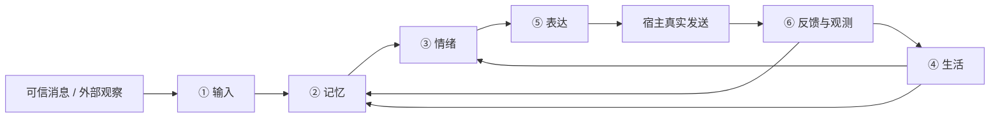

# 架构：一个六层核心，宿主执行真实动作

六层是同一套运行流程，不是六个服务或六次模型调用。情绪判断复用当前回复/后台模型，程序负责保存、限幅、去重与衰减。实际调用见 [CURRENT_RULES](CURRENT_RULES.md)。

## 代码、状态与动作的分工

| 部分 | 持有什么 | 不负责什么 |
|---|---|---|
| 核心运行时 | 原话与记忆、情绪/期待、生活过程、身份范围和事件回执 | 平台账号权限、浏览器或生图服务 |
| 已安装插件 | 所选能力的协议、状态和相关观察 | 自建另一套人格/情绪，或每轮无关查询 |
| 宿主 | 可信消息、同一回复模型、原生工具、调度与真实投递 | 用聊天承诺代替实际运行证据 |
| 可选页面 | 紧凑状态的展示与管理入口 | 打开页面就调用模型、改写情绪或复制全库 |
| 私有备份 | 原格式数据库、原生文档和显式许可的插件快照 | 第二套在线运行账本或可直接激活的旧任务 |

核心 SQLite 保存 source_events、memories、情绪与 ct_* 扩展状态。阅读/相机等插件表在该库中随快照一次备份；记账等独立空间数据库保持自己的唯一正本，只在归档时导出一致快照。

源码、私人状态根目录、原生人格与私库工作树分开。原始资料是数据，不授予工具权限或角色身份。遗留 memory_bridge 保持原交换接口；它的 Muse 行转换器不是新的聊天平台适配器。

## 速度边界

普通对话只做可信取源、有界检索、同模型评估保存及表达决策。浏览、生图、摘要、索引、合并、全库检查和备份放在既有后台流程。小屋读取紧凑状态，角色模型独立缓存。适用字段与宿主限制分别见模块契约。

新根目录 init 配置 companion_v2，但总开关停用；旧根目录不自动切协议。升级程序不会替宿主改 prompt、注册原生任务或自动获得权限。

## 本阶段完成范围

Kit 0.15.1 只统一入口、能力目录与文档分工。四个独立插件已在仓库，其他能力尚未全部抽离；通用平台适配器与第二平台验收未实现。后续见 [分阶段路线](CORE_PLUGINS_PROPOSAL.md)，安装 Agent 不执行研发路线。
